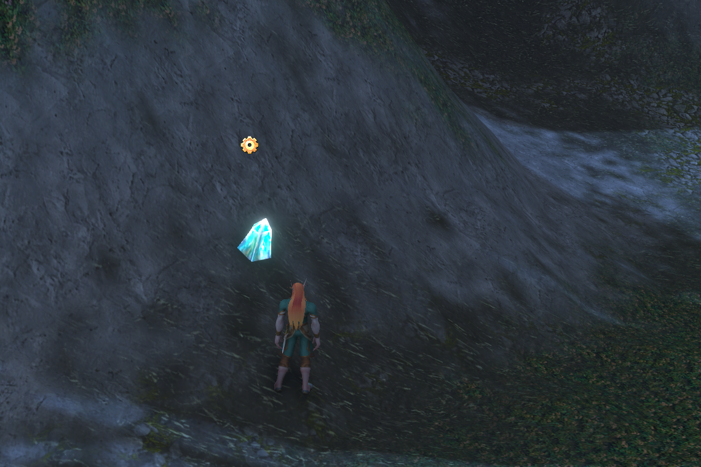
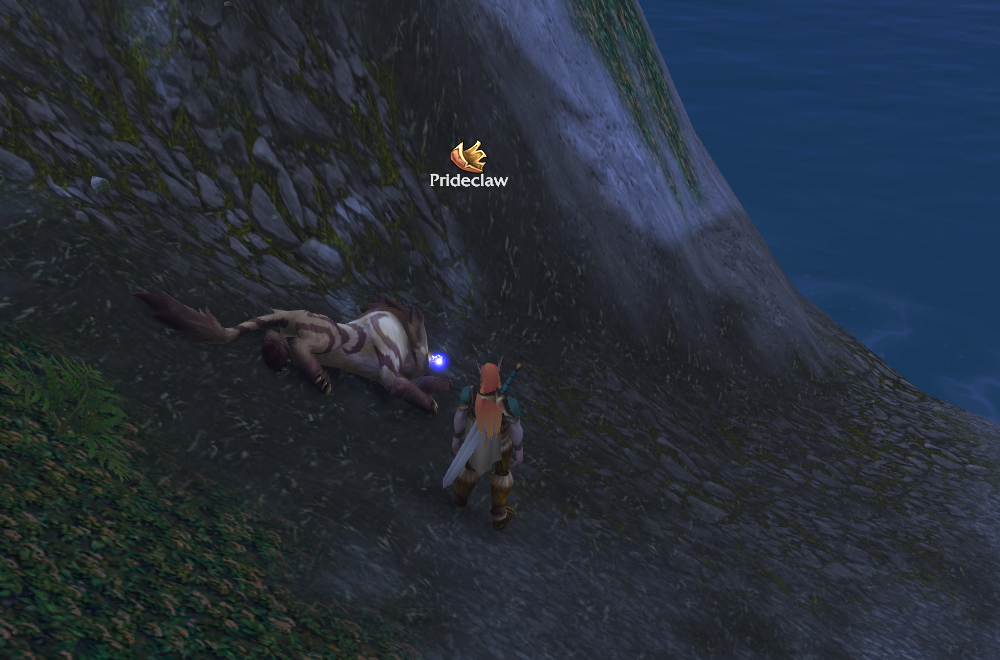

# Forever LootKey

A small addon for **World of Warcraft: Forever**. Press one key and you loot the nearest corpse or pick up the nearest quest object. You don't have to aim, click or target anything.

## What it does

- **One key for looting.** It turns on the game's own *soft-target interact*. The nearest corpse, quest item, herb, ore node or chest within 10 yards becomes your interact target, and your **Interact with Target** key uses it.
- **Instant auto loot.** It turns on auto loot and takes every item as soon as the loot is ready, so the loot window never stays open. Hold your auto-loot modifier (Shift by default) to loot by hand.
- **Highlight.** The game shows a large icon and the name over the object your key will use, which makes quest items on floors and walls and skinnable corpses easy to spot. The client shows it for one object at a time, within interact range.

The addon only uses settings and APIs that the game client provides. You still press a key for every loot, and it does not automate anything.

## Setup

1. Install the addon and log in. It applies its settings once and prints a confirmation in chat.
2. Open **Options → Keybindings → Targeting** and bind a key to **Interact with Target**. The mouse wheel or a side mouse button works well.
3. Walk up to a corpse and press the key.

## Commands

| Command | What it does |
|---|---|
| `/lootkey` | Show help |
| `/lootkey who` | Show what the interact key would use right now, plus the current mode and range |
| `/lootkey range <3-30>` | Set the interact range in yards (default 10) |
| `/lootkey icon <16-128>` | Set the size of the icon over the target (default 64) |
| `/lootkey on` | Apply the settings again |
| `/lootkey off` | Restore the settings you had before the addon. Run this before you uninstall |

`/flk` works as a short alias.

## Why the range is 10 yards

Loot range is short. With a larger range the key can latch onto an NPC or object further away, and then nothing happens when you press it. Ten yards matches the client default and works well for looting. If you mostly want to see the highlight icons from further away, raise it with `/lootkey range`.

## Changed game settings

| Setting | Value |
|---|---|
| `autoLootDefault` | 1 |
| `softTargetInteract` | 3 |
| `SoftTargetIconGameObject` | 1 |
| `SoftTargetIconInteract` | 1 |
| `SoftTargetInteractArc` | 2 |
| `SoftTargetInteractRange` | 10 |
| `SoftTargetWorldtextSize` | 64 |
| `SoftTargetLowPriorityIcons` | 1 |
| `SoftTargetNameplateInteract` | 1 |

The addon saves your previous values the first time it runs. `/lootkey off` puts them back.

## Languages

English and Russian.

## License

MIT
